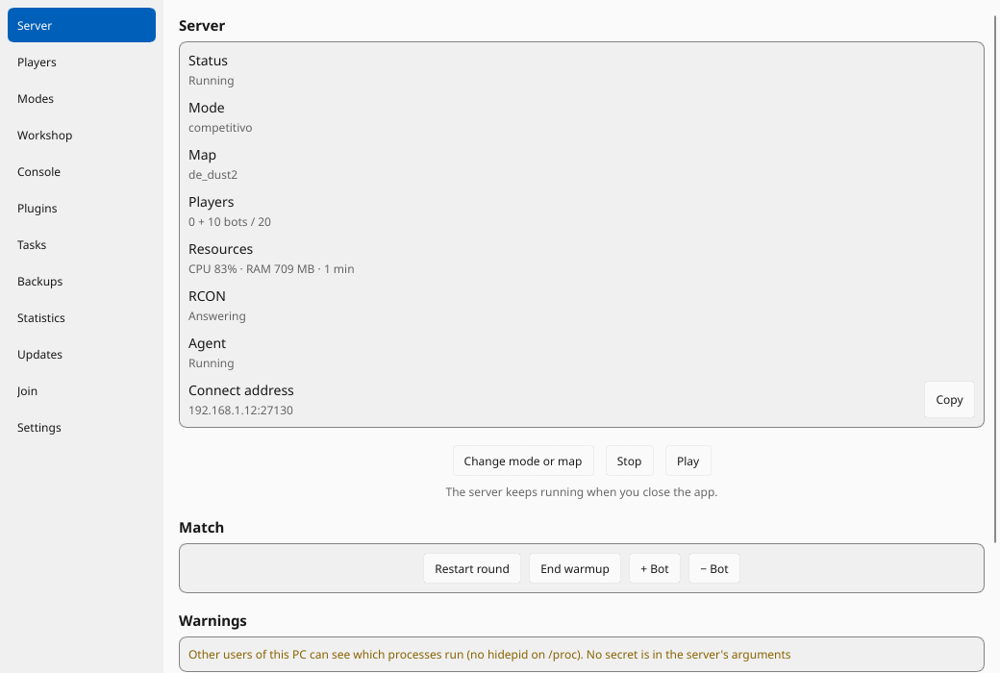
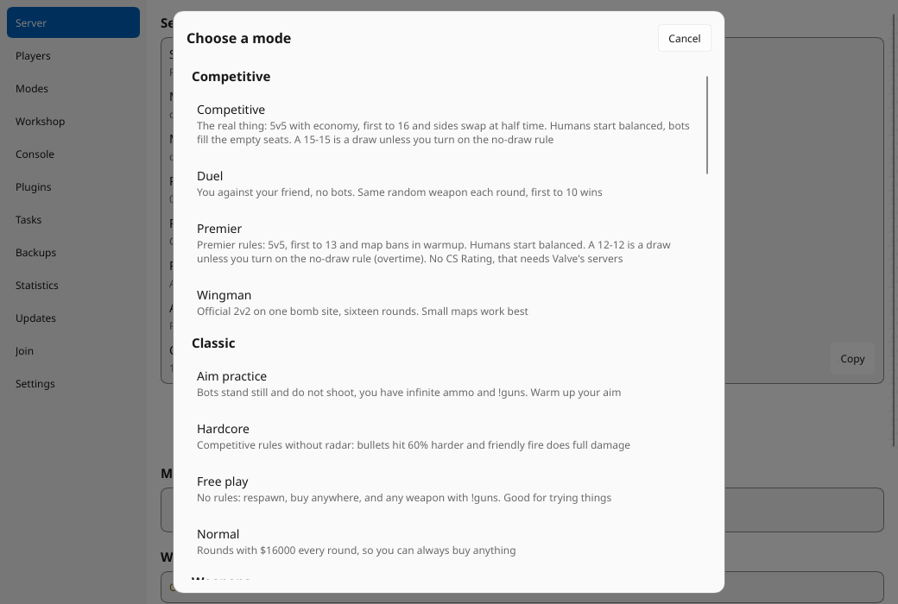
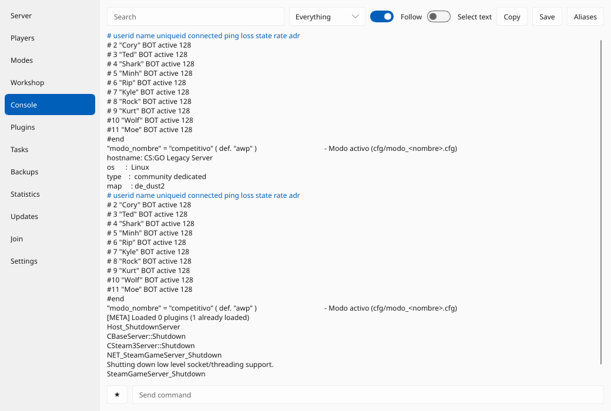
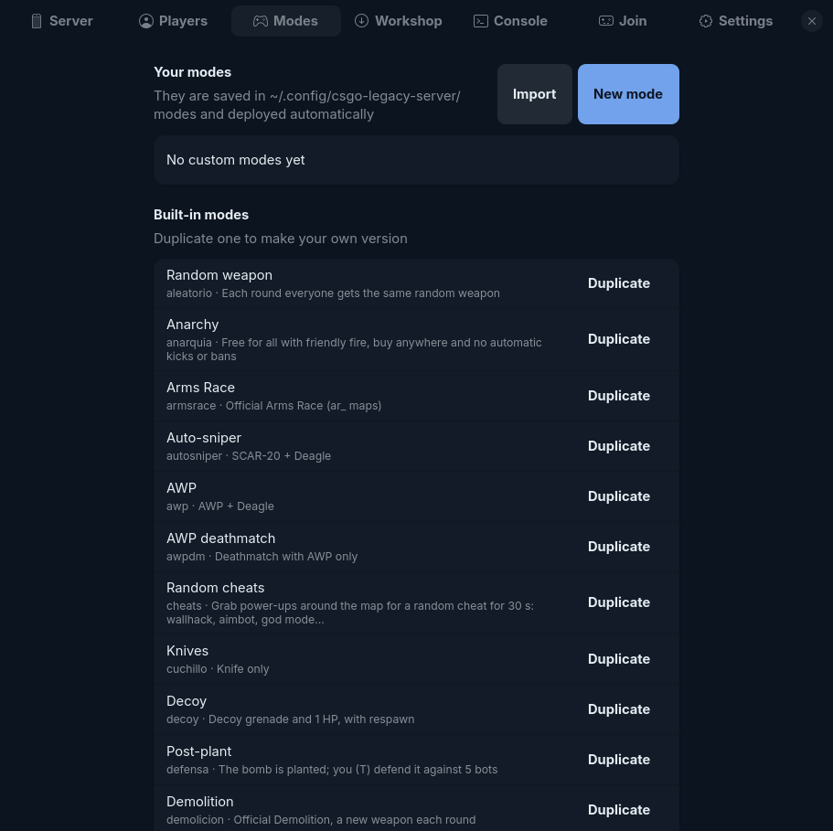
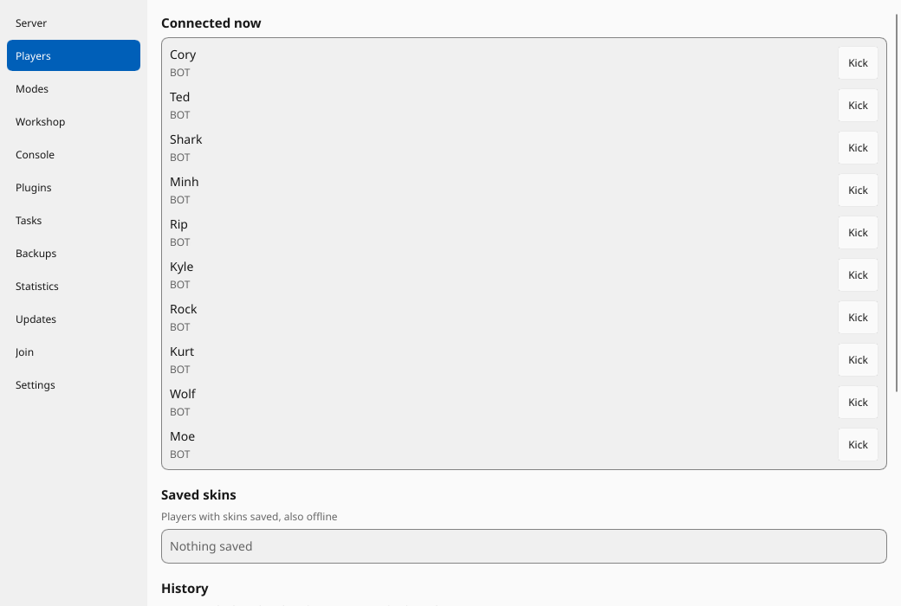
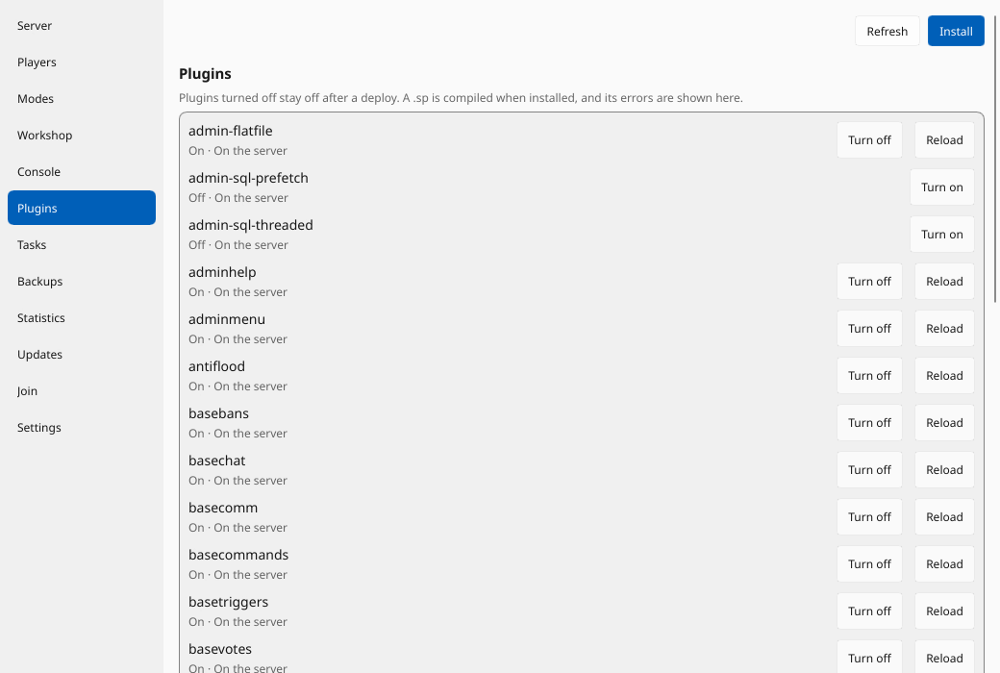

# CS:GO Legacy Server

[English](README.md) · [Changelog](CHANGELOG.md) (en inglés) · [Contribuir](CONTRIBUTING.md) (en inglés)

[](https://github.com/xsteban1410/CSGO-Server/actions/workflows/ci.yml)

Aloja un servidor dedicado **CS:GO Legacy** (aplicación 740) y juega con amigos contra bots, desde una aplicación de escritorio o la línea de comandos.
Los modos de juego, complementos y herramientas de administración provienen de [CSGO-Hub](https://github.com/xsteban1410/CSGO-Hub) (francotiradores, oleadas de zombies, retomas, Guardian, trucos aleatorios, máscaras…), que se instalan desde la pestaña Hub de la aplicación. Compila complementos de SourceMod por sí mismo, tiene administradores con roles y su propio antitrampas, y busca mapas en Steam Workshop.

Funciona en cualquier distro de 64 bits con glibc y librerías de 32 bits. Probado en Arch/CachyOS.

<p> </p>
<p> </p>
<p> </p>

## Instalación

**Arch Linux:** abre la [última versión](https://github.com/xsteban1410/CSGO-Server/releases/latest) y ejecuta el comando
`sudo pacman -U …` de sus notas. El paquete del AUR todavía no está publicado.

Los siguientes paquetes vienen con versiones posteriores a la 1.1.0:

**Debian 12 o posterior, Ubuntu 24.04 o posterior:** descargue el `.deb` de la versión y ejecute `sudo apt install ./csgo-legacy-server_*_amd64.deb`.

**Cualquier distribución, AppImage:** descárgala, `chmod +x` y ejecútala. Necesita fontconfig, freetype y glibc 2.36 o posterior. Con argumentos es la línea de comando: `./csgo-legacy-server-*.AppImage status`. No se agrega al menú de su aplicación.

**Cualquier distribución, Flatpak:** `flatpak install --user csgo-legacy-server-*.flatpak`. Está en un espacio aislado: el servidor se detiene cuando cierras la aplicación, abres el juego tú mismo y escribes el comando `connect` que se muestra.

Cada versión tiene un archivo `SHA256SUMS`: `sha256sum -c SHA256SUMS --ignore-missing`.

**Desde la fuente** (cualquier distribución; necesita Rust, Go para el agente y los archivos de desarrollo fontconfig, freetype, xkbcommon y Wayland):

```bash
git clone https://github.com/xsteban1410/CSGO-Server.git && cd CSGO-Server
cargo build --release
(cd go && go build -o ../target/release/csgo-legacy-server-agent ./cmd/agent)   # optional: history and scheduled tasks
./target/release/csgo-legacy-server-app       # run from the repo: it finds game/ here
```

Para instalar en otro lugar, copie `cfg/ modes/ plugin/ data/` de `game/` a `<prefix>/share/csgo-legacy-server/` junto a
`<prefijo>/bin`, o apunta `CSLS_RESOURCES` a una carpeta que los tenga.

### Primer arranque

No se descarga nada hasta que usted lo solicite. **Crear un servidor** busca primero una instalación existente (cualquier carpeta con `srcds_run`) y la reutiliza. De lo contrario, elija una carpeta (~40 GB libres) y descargará SteamCMD, el servidor dedicado (~33 GB), Metamod:Source y SourceMod, luego compilará los complementos. La descarga continúa en segundo plano si cierra la aplicación y se reanuda si se interrumpe.

La aplicación viene sin modos de juego: la pestaña Servidor ofrece **Instalar todos los modos**, o selecciónelos en la pestaña **Hub** (`csgo-legacy-server hub install pack-all` desde la línea de comando).

Sin pantalla: `csgo-legacy-server install` hace lo mismo, y `csgo-legacy-server doctor` dice qué falta y el comando
exacto para tu distro (apt, pacman, dnf, zypper, xbps, emerge).

Cada jugador necesita **CS2 con la beta `csgo_legacy`** (Steam › CS2 › Propiedades › Betas) y entra con `connect IP:PUERTO`.
El botón **Jugar** de la app (o `csgo-legacy-server play local`) abre CS:GO Legacy conectando ya a tu servidor.

## La app

| Pestaña | |
|---|---|
| Servidor | estado, jugadores, CPU, RAM, rcon y agente, advertencias y eventos recientes, dirección de conexión, inicio (modo → mapa → opciones → red), cambiar modo o mapa en vivo, reiniciar ronda, finalizar calentamiento, agregar/eliminar bots, ajustes preestablecidos, el puente al servidor de un amigo a través de VPN |
| Jugadores | expulsar, prohibir (minutos o permanente, con motivo), lista de prohibiciones y desbancar, administradores y sus roles, máscaras guardadas, historial de conexiones, sanciones (también detecciones anti-trampas) con notas, exportar a CSV y JSON |
| Modos | crea tus propios modos o duplica uno instalado, con armas, salud, velocidad, tiempo de ronda, bots y una vista previa del cfg; bloques de reglas como "cuando ocurre una muerte, agrega 25 de salud"; importar/exportar como `.toml` para compartirlos |
| Centro | modos de juego, complementos, herramientas de administración y paquetes de CSGO-Hub, con vistas previas: instalar con lo que necesitan, actualizar, eliminar |
| Workshop | busca mapas sin clave de API, instala por ID o enlace (también colecciones), genera la navegación de bots, importa un `.bsp` local |
| Consola | registro del servidor en vivo con filtros y búsqueda, comandos rcon con autocompletar, historial, favoritos y alias, guarde el registro |
| Complementos | encender y apagar, instalar `.sp` o `.smx`, recargar, volver a una versión anterior; Los errores de compilación se muestran aquí. |
| Tareas | reinicios programados, cambios de mapa o modo, comandos rcon, copias de seguridad e implementaciones de complementos, con ejecuciones recientes (necesita el agente) |
| Copias de seguridad | crear, restaurar con una vista previa de los cambios, mantener la última N |
| Estadística | jugadores por día, actividad por hora, mapas y modos; almacenado solo en esta PC, nunca en direcciones IP, y puede borrarlo (necesita el agente) |
| Actualizaciones | solicite a GitHub una nueva versión, solo cuando lo presione o active la marca; nada se instala solo |
| Ajustes | nombre, contraseña, perfil de red, puerto, tickrate, GSLT, complemento de máscaras, anticheat, actualizar el servidor |

El servidor se ejecuta como una unidad `systemd --user`, por lo que sigue ejecutándose cuando cierras la aplicación (no en Flatpak).

Al cerrar la ventana, la aplicación queda en la bandeja del sistema, con el estado, iniciar, detener y salir. La bandeja necesita un host StatusNotifier: GNOME necesita la extensión AppIndicator y, sin una bandeja que cierre la ventana, sale de la aplicación.

## Perfiles de red

| Perfil | Para qué |
|---|---|
| LAN | jugadores de tu red local (`sv_lan 1`) |
| Amigos a través de VPN | Tailscale, ZeroTier…: Steam descarta clientes que se conectan a una IP VPN, por lo que el servidor permanece en modo LAN y un puente UDP en PORT+1 reenvía a tus amigos. Cada amigo inicia el puente en la pestaña Servidor (**El servidor de un amigo a través de VPN** o `csgo-legacy-server bridge 27030 <your VPN IP>:27031`) y se conecta a **su propia** IP local |
| Internet | puerto UDP abierto; muestra tu IP pública, te da el comando del cortafuegos (ufw/firewalld) y puede abrir el puerto del router por UPnP (`miniupnpc`) |
| Comunitario | Internet + un [token GSLT](https://steamcommunity.com/dev/managegameservers) (app 730) para salir en el navegador de servidores de Steam |

## Terminal

```
csgo-legacy-server start [modo] [alone|N] [opciones]   arrancar el servidor
csgo-legacy-server mode  <modo> [alone|N] [opciones]   cambiar de modo/mapa encendido
csgo-legacy-server stop | status | players | maps | modes
csgo-legacy-server kick <userid> | ban <userid> <minutos> [motivo] | unban <STEAM_1:x:y>
csgo-legacy-server bots +2 | bots -1 | round [--warmup]
csgo-legacy-server hub list|search|info|install|update|remove   modes and plugins from CSGO-Hub
csgo-legacy-server admins list|add|remove|role|password          admins and roles for the game
csgo-legacy-server workshop search|install|list|remove|import
csgo-legacy-server mode-file export|import|delete      compartir modos propios
csgo-legacy-server presets [--delete nombre]           opciones de arranque guardadas
csgo-legacy-server backup create | list | restore <file> [--dry-run]   your config, modes, plugins, presets and skins
csgo-legacy-server deploy [--force] [--watch]          compilar plugins, copiar configs
csgo-legacy-server agent start | stop | status        optional helper: history and scheduled tasks
csgo-legacy-server alias [name command...] [--delete] console shortcuts, also for rcon
csgo-legacy-server plugins list|enable|disable|install|reload   plugins on the server
csgo-legacy-server updates [--json]                   ask GitHub for the latest release
csgo-legacy-server nav [--force]                       navegación de bots del mapa actual
csgo-legacy-server skins                               rehacer la lista de skins tras actualizar el juego
csgo-legacy-server rcon "command" | play [local|IP:PORT] | bridge | doctor | install [--update]
```

Opciones de start/mode: `-m/--map`, `-t/--type competitive|short|casual|wingman|dm|ffa|tdm|armsrace|demolition|guardian|dz`, `-d/--difficulty 0-3`, `-b/--bots`,
`-r/--rounds`, `-s/--site a|b|random`, `--no-bots`, `--teams versus|together|free` (modos competitivos, donde comienzan los humanos), `--no-draw` (`competitivo` y `premier`: tiempo extra hasta que alguien gane), `-p/--precision` (sin propagación ni retroceso para todos), `--anarchy`,
`-w/--workshop ID`, `--set cvar=valor` (repetible), `--preset NOMBRE`, `--save-preset NOMBRE`.

```bash
csgo-legacy-server start awp alone
csgo-legacy-server mode retake 2 -s b -d 2 -m de_inferno
csgo-legacy-server mode zombies --set modo_z_oleadas=10 --set modo_z_vida=400
csgo-legacy-server start premier 2 --teams versus
```

## Modos

Los modos se encuentran en [CSGO-Hub](https://github.com/xsteban1410/CSGO-Hub), por lo que se puede arreglar o agregar un modo sin una nueva versión de la aplicación: `pack-all` los tiene todos, `pack-valve` los oficiales, y cada elemento dice qué es y qué necesita. `csgo-legacy-server modes` enumera los instalados.

Cada uno elige su propio equipo, como en un servidor comunitario o de Valve. Los bots (expertos) llenan los asientos vacíos y se van cuando se une un humano; `--no-bots` solo juega con humanos. El calentamiento termina solo a menos que le pidas que espere a los jugadores (`start awp 2`). Sólo los modos cuyas reglas necesitan bandos las arreglan.

**Partidos competitivos** (`competitivo`, `premier`, `wingman`, `duelo`) son partidos normales, no reglas personalizadas: economía e intercambio de lados en el medio tiempo. `competitivo` y `premier` inician a los humanos equilibrados, por lo que dos humanos obtienen un lado cada uno; `--teams` (o **Equipos** en el asistente) cambia el lugar donde comienzan y cualquiera puede cambiar de equipo después. Los robots llenan los asientos vacíos. Un empate es un empate, a menos que actives `--no-draw` (**No hay empates** en el asistente), que juega tiempo extra hasta que alguien gana. En `competitivo`, `premier` y `wingman` el partido comienza cuando todos escriben `!ready` o cuando finaliza el calentamiento; `duelo` termina su calentamiento. En `premier`, los humanos se turnan para prohibir mapas durante el calentamiento, a menos que elijas un mapa al comenzar. No tiene clasificación CS ni emparejamiento, que necesitan los servidores de Valve.

Ajustes por equipo para tus modos o `--set` (`t` o `ct`): `modo_<eq>_quitar`, `_arma`, `_pistola`, `_objeto`,
`_vida`, `_velocidad`, `_color` (`R,G,B`).

**Anarquía** (`--anarchy` con cualquier modo): sin expulsiones ni prohibiciones automáticas (inactivo, muertes en equipo, expulsión de votos, inundación, espacios reservados). Las patadas y prohibiciones que realices desde la aplicación seguirán funcionando.

### Administradores y antitrampas

Los administradores son SteamID con una función (pestaña Jugadores o `csgo-legacy-server admins add STEAM_1:0:123 --name Ana --role admin`). Los roles otorgan `console`, `kick`, `ban`, `map`, `slay`, `chat`, `cheats`, `bots` o `root`; los valores predeterminados son `owner`, `admin`, `moderator` y `cheats`. El servidor se ejecuta con `-insecure`, donde se puede falsificar un SteamID, por lo que los roles con la consola del servidor (`sm_rcon`) también deben escribirse `sm_login <password>` en la consola de juegos: se expulsan tres contraseñas incorrectas y se expulsa a un segundo jugador con un SteamID de administrador. Las herramientas de administración como `!am` (aimbot) y `!wh` (wallhack) son elementos centrales (`pack-admin`) y necesitan el permiso `cheats`.

El antitrampas (Configuración, o `[anticheat]` en la configuración) busca ángulos de visión imposibles, apunta justo antes de matar, saltos de conejo programados, cvars de cliente speedhack y wallhack, y registros, patadas o prohibiciones. No puede ver un wallhack que solo se dibuja en la PC del jugador. Las detecciones se muestran en la pestaña Jugadores con las sanciones.

### Tus modos y plugins

- Elementos del Hub: `~/.local/share/csgo-legacy-server/hub/<id>/`, administrados por la pestaña Hub o `hub install|remove`.
- Modos: `~/.config/csgo-legacy-server/modes/<id>.toml` + `<id>.cfg` (la pestaña Modos los escribe por usted). Ganan en un modo hub con la misma identificación.
- Complementos: coloque un `.sp` (o `name/name.sp`) en `~/.config/csgo-legacy-server/plugins/`, o use `plugins install`.

Con la app abierta (o `deploy --watch`) lo nuevo o cambiado se compila y se recarga en el servidor encendido; los errores
de compilación salen con su línea y el servidor sigue con la versión anterior. Los plugins borrados se descargan.

### Copias de seguridad

`backup create` (o la pestaña **Copias de seguridad**) guarda su configuración, modos, complementos, ajustes preestablecidos y máscaras en `~/.local/share/csgo-legacy-server/backups/`, nunca en el servidor. `install --update` hace uno primero y se queda con los últimos cinco automáticos. `restore --dry-run` muestra lo que cambiaría, y una restauración guarda primero los archivos actuales y deja los archivos que la copia de seguridad no tiene. Las copias de seguridad contienen sus contraseñas, así que no las comparta.

## Mapas del workshop

Busca en la pestaña Workshop o con `csgo-legacy-server workshop search aim`. Los mapas de CS2 (Source 2) no funcionan en
CS:GO Legacy y salen marcados como incompatibles. Los instalados van a `maps/csls/<id>/` y aparecen en el paso de mapa. Los
bots solo se mueven en mapas con malla de navegación: pulsa **Generar .nav** (o `nav`) con el mapa cargado. Los mapas de
surf, bhop y KZ no sirven para bots.

## Comandos en el chat del juego

| | |
| `!ready` / `!listo` | comenzar el partido sin esperar a que termine el calentamiento (modos competitivos) |
| `sm_login <password>` | en la consola (~): desbloquea la consola del servidor para tu rol de administrador |
| `!ws`, `!knife` | pieles y cuchillos, con el elemento central `skins` |
| `!guns` / `!armas` | cualquier arma (modos de juego libre y práctica de puntería, desde el centro) |
| `!am`, `!wh`, `!nc`, `!god`, `!tp`, `!bring`, `!respawn`, `!hp`, `!bots` | herramientas de administración de `pack-admin`, para roles con permiso |
| `!armas` / `!guns` | cualquier arma (solo en el modo libre) |
Las opciones se guardan por SteamID y se aplican cada vez que te unes. El idioma elegido en Configuración (inglés por defecto o español) se aplica a la aplicación, la línea de comando, los nombres de los skins y los mensajes del juego para cada jugador.
Se guarda por SteamID y se aplica cada vez que entras. Los mensajes salen en el idioma del juego de cada jugador (inglés/español).

## Archivos

| | |
|---|---|
| `~/.config/csgo-legacy-server/config.toml` | ajustes (lleva la contraseña rcon, permisos 600) |
| `~/.config/csgo-legacy-server/{modes,plugins,presets.toml}` | tus modos, plugins y presets |
| `crates/core`, `crates/cli`, `crates/app` | Rust: biblioteca principal, línea de comandos, aplicación de escritorio Slint |
| `game/plugin/`, `game/cfg/` | Los complementos y la API de SourceMod del motor (`include/csls.inc`) y las configuraciones en las que se ejecuta cada modo |
| `go/` | El agente y las herramientas de prueba. |
| `docs/ARCHITECTURE.md`, `docs/HUB.md`, `docs/TROUBLESHOOTING.md`, `docs/PRIVACY.md` | Cómo encajan las piezas, el formato del centro, cómo solucionar problemas y qué datos se conservan |

## Notas y límites

- Sin demorarse, systemd detiene los servicios del usuario cuando cierra la sesión, y el servidor con ellos. Para que siga funcionando, ejecute `loginctl enable-linger`; `doctor` te indica si está apagado.
- `doctor --report` imprime un informe sobre problemas con contraseñas, IP e ID de Steam ocultos, y `status --json` está destinado a scripts.
- Los paquetes instalan terminaciones de shell. De la fuente: `csgo-legacy-server completions fish > ~/.config/fish/completions/csgo-legacy-server.fish` (también `bash` y `zsh`).

- `game/plugin/csls_directconnect` parchea el motor en la memoria para que los jugadores puedan unirse por IP sin un lobby de emparejamiento. Es Linux
  para Linux corresponden al `engine.so` actual; si Valve actualiza los binarios del servidor, el log dirá "signature not
  found" y habrá que volver a sacarlas. La idea viene de [NoLobbyReservation](https://github.com/vanz666/NoLobbyReservation).
- El servidor arranca con `-insecure` (sin VAC). Las skins son cosméticas y solo se ven en este servidor; los skin changers van
  reglas para servidores GSLT públicos, por lo que las máscaras son un elemento central que puede omitir o desactivar en Configuración. Herramientas de administración como
  El aimbot solo funciona en su propio servidor `-insecure`, para los roles a los que le dio ese permiso.
- Jugado en Arch Linux y CachyOS. CI compila y prueba todo en Debian y Fedora, y prueba `.deb`, AppImage y Flatpak, pero nadie ha jugado con ellos todavía. No probado en distribuciones musl o SteamOS (sistema de solo lectura: use distrobox). Sin guantes.

## Ramas

`master` es la versión estable, y las releases salen de ella. Lo nuevo y las contribuciones van primero a `pre-releases`, que
pasa sola a `master` tras tres días sin problemas. Los detalles están en [CONTRIBUTING.md](CONTRIBUTING.md#branches).

## Licencia

GPL-3.0-or-later. Ver [LICENSE](LICENSE).
