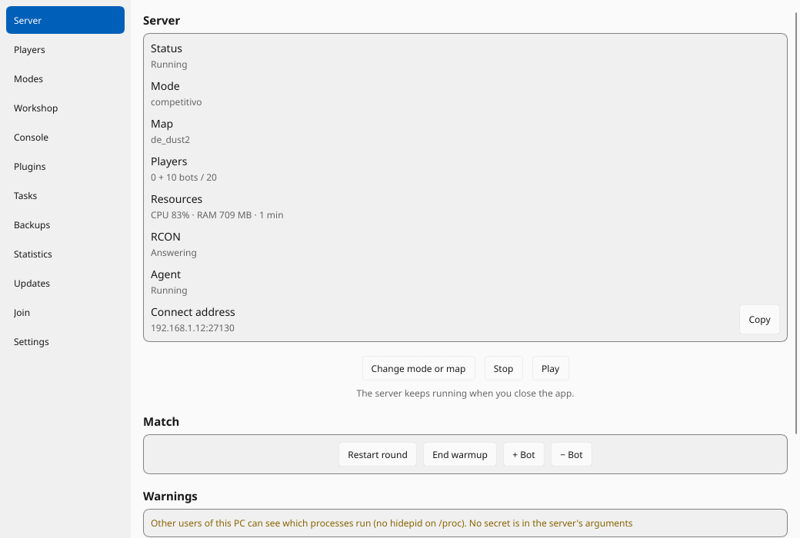
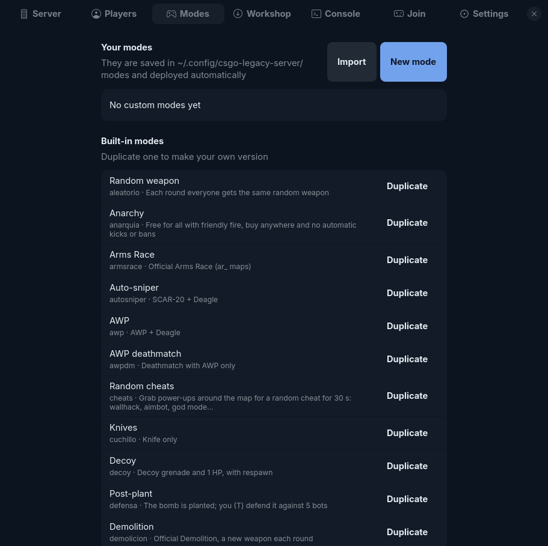

# CS:GO Legacy Server

[Español](README.es.md) · [Changelog](CHANGELOG.md) · [Contributing](CONTRIBUTING.md)

[](https://github.com/xsteban1410/CSGO-Server/actions/workflows/ci.yml)

Host a **CS:GO Legacy** dedicated server (app 740) and play with friends against bots, from a GTK app or the command line.
It ships more than 30 game modes (snipers, zombie waves, retakes, Guardian, random cheats, anarchy…), remembers every
player's skins, compiles SourceMod plugins by itself and browses the Steam Workshop for maps.

Works on any 64-bit glibc distro with 32-bit libraries. Tested on Arch/CachyOS.

<p> </p>

## Install

**Arch Linux:** open the [latest release](https://github.com/xsteban1410/CSGO-Server/releases/latest) and run the
`sudo pacman -U …` command from its notes. The AUR package is not published yet.

**From source** (any distro; needs Rust, GTK 4 ≥ 4.14 and libadwaita ≥ 1.6 development files):

```bash
git clone https://github.com/xsteban1410/CSGO-Server.git && cd CSGO-Server
cargo build --release
./target/release/csgo-legacy-server-gtk       # run from the repo: it finds cfg/, modes/ and plugin/ here
```

To install elsewhere, copy `cfg/ modes/ plugin/ data/` to `<prefix>/share/csgo-legacy-server/` next to
`<prefix>/bin`, or point `CSLS_RESOURCES` at a folder that has them.

### First run

Nothing is downloaded until you ask. The app offers **Create a server** or **Just join servers**:

- *Create a server* looks for an existing install first (any folder with `srcds_run`) and reuses it. Otherwise pick a
  folder (~40 GB free), and it downloads SteamCMD, the dedicated server (~33 GB), Metamod:Source and SourceMod, then compiles
  the plugins. The download keeps going in the background if you close the app, and resumes if it is interrupted.
- *Just join* skips all of that: it is for friends who only play.

Headless: `csgo-legacy-server install` does the same, and `csgo-legacy-server doctor` tells you what is missing and the
exact command for your distro (apt, pacman, dnf, zypper, xbps, emerge).

Players need **CS2 with the `csgo_legacy` beta** (Steam › CS2 › Properties › Betas) and join with `connect IP:PORT`.
The app's **Play** button (or `csgo-legacy-server play local`) opens CS:GO Legacy already connecting to your server.

## The app

| Tab | |
|---|---|
| Server | status, connect address, Start (mode → map → options → network), change mode or map live, restart round, end warmup, add/remove bots, presets |
| Players | kick, ban (minutes or permanent, with reason), bans list and unban, each player's saved skins |
| Modes | make your own modes or duplicate a built-in one; import/export as `.toml` to share them |
| Workshop | search maps without an API key, install by ID or link (collections too), generate bot navigation, import a local `.bsp` |
| Console | live server log and rcon commands |
| Join | join a friend's server; with a 100.x IP it turns the VPN bridge on, tests the connection and gives the exact `connect` |
| Settings | name, password, network profile, port, tickrate, GSLT, skins plugin, update the server |

The server runs as a `systemd --user` unit, so it keeps running when you close the app.

## Network profiles

| Profile | Use it for |
|---|---|
| LAN | players on your local network (`sv_lan 1`) |
| Friends over VPN | Tailscale, ZeroTier…: Steam drops clients that connect to a VPN IP, so the server stays in LAN mode and a UDP bridge on PORT+1 forwards your friends. Each friend opens the **Join** tab (or runs `csgo-legacy-server bridge 27030 <your VPN IP>:27031`) and connects to **their own** local IP |
| Internet | open UDP port; shows your public IP, tells you the firewall command (ufw/firewalld) and can open the router port with UPnP (`miniupnpc`) |
| Community | Internet + a [GSLT token](https://steamcommunity.com/dev/managegameservers) (app 730) so the server shows up in Steam's server browser |

## Command line

```
csgo-legacy-server start [mode] [alone|N] [options]   start the server
csgo-legacy-server mode  <mode> [alone|N] [options]   change mode/map while running
csgo-legacy-server stop | status | players | maps | modes
csgo-legacy-server kick <userid> | ban <userid> <minutes> [reason] | unban <STEAM_1:x:y>
csgo-legacy-server bots +2 | bots -1 | round [--warmup]
csgo-legacy-server workshop search|install|list|remove|import
csgo-legacy-server mode-file export|import|delete     share custom modes
csgo-legacy-server presets [--delete name]            saved start options
csgo-legacy-server backup create | list | restore <file> [--dry-run]   your config, modes, plugins, presets and skins
csgo-legacy-server deploy [--force] [--watch]         compile plugins, copy configs
csgo-legacy-server nav [--force]                      bot navigation for the current map
csgo-legacy-server skins                              rebuild the skins list after a game update
csgo-legacy-server rcon "command" | play [cs2|local|IP:PORT] | bridge | doctor | install [--update]
```

Start/mode options: `-m/--map`, `-t/--type competitive|short|casual|wingman|dm|ffa|tdm|armsrace|demolition|guardian|dz`, `-d/--difficulty 0-3`, `-b/--bots`,
`-r/--rounds`, `-s/--site a|b|random`, `--teams together|versus|free` (competitive modes), `-p/--precision` (no spread or recoil for everyone), `--anarchy`,
`-w/--workshop ID`, `--set cvar=value` (repeatable), `--preset NAME`, `--save-preset NAME`.

```bash
csgo-legacy-server start awp alone
csgo-legacy-server mode retake 2 -s b -d 2 -m de_inferno
csgo-legacy-server mode zombies --set modo_z_oleadas=10 --set modo_z_vida=400
csgo-legacy-server start premier 2 --teams versus
```

## Modes

Humans play CT and bots T (5, expert) unless the mode says otherwise.

| Mode | |
|---|---|
| `aim` | **Aim practice** — Bots stand still and do not shoot, you have infinite ammo and !guns. Warm up your aim |
| `aleatorio` | **Random weapon** — Each round everyone gets the same random weapon, from AWP to Zeus |
| `anarquia` | **Anarchy** — Chaos: everyone against everyone with friendly fire, respawn, buy anywhere, and nobody gets kicked |
| `armsrace` | **Arms Race** — Official: each kill gives you the next weapon, the first to the golden knife wins. Its own ar_ maps |
| `autosniper` | **Auto-sniper** — Everyone gets a SCAR-20 and a Deagle. Short rounds, no buying |
| `awp` | **AWP** — Everyone gets an AWP and a Deagle. Short rounds, no buying |
| `awpdm` | **AWP deathmatch** — Deathmatch with only AWP and Deagle |
| `cheats` | **Random cheats** — Grab glowing power-ups for a random cheat for 30 s: wallhack, aimbot, god mode… |
| `clutch` | **Clutch** — Each round you win adds a bot, each round you lose removes one. How many can you beat? |
| `competitivo` | **Competitive** — The real thing: 5v5 with economy, first to 16, sides swap at half time and overtime. Bots fill the empty seats |
| `cuchillo` | **Knives** — Knife only. Short rounds |
| `dangerzone` | **Danger Zone** — Official battle royale on dz_ maps: find gear, avoid the storm, be the last one standing |
| `decoy` | **Decoy** — Deathmatch with 1 HP and endless decoys: a direct hit kills |
| `defensa` | **Post-plant** — The opposite of Retake: the bomb is planted and you (T) defend it from 5 bots coming to defuse |
| `demolicion` | **Demolition** — Official: bomb rounds where you get a new weapon each round for your kills. Small maps |
| `dm` | **Deathmatch** — Official deathmatch: buy from the menu, respawn at once, 10 minutes |
| `dmcabeza` | **Headshot deathmatch** — Deathmatch where only shots to the head do damage |
| `dmcuchillo` | **Knife deathmatch** — Deathmatch with knives only |
| `duelo` | **Duel** — You against your friend, no bots. Same random weapon each round, first to 10 wins |
| `escopetas` | **Shotguns** — Everyone gets an XM1014 and a P250. Short rounds, no buying |
| `ffa` | **Free-for-all** — Deathmatch where everyone is your enemy, your friend too |
| `flyingscout` | **Flying Scoutsman** — Official War Game: SSG 08, very low gravity, bunny hops and perfect accuracy in the air |
| `guardian` | **Guardian** — Official co-op: defend the zone against waves of bots, on gd_ maps |
| `hardcore` | **Hardcore** — Competitive rules without radar: bullets hit 60% harder and friendly fire does full damage |
| `headshot` | **Headshots only** — AK-47 and Deagle, and only shots to the head do damage |
| `jefe` | **Boss** — Normal rounds, but one bot each round is a slow red giant with 5000 HP |
| `libre` | **Free play** — No rules: respawn, buy anywhere, and any weapon with !guns. Good for trying things |
| `luna` | **Moon** — AWP and Deagle with very low gravity, as if on the Moon |
| `negev` | **Negev** — Everyone gets a Negev and nothing else. Short rounds, no buying |
| `ninjas` | **Ninjas** — Fast, almost invisible bots with knives hunt you. Buy what you want and listen for them |
| `normal` | **Normal** — Rounds against 5 bots with $16000 every round, so you can always buy anything |
| `pesados` | **Heavy armor** — Everyone in a Heavy Assault Suit with an M249: tough and slow |
| `pistolas` | **Deagle** — Everyone gets only a Deagle. Short rounds, no buying |
| `premier` | **Premier** — Premier rules: 5v5, first to 13, overtime and map bans in warmup. No CS Rating, that needs Valve's servers |
| `rehenes` | **Hostages** — You (CT) rescue the hostages from 5 bots, on cs_ maps |
| `retake` | **Retake** — The bomb is already planted and you (CT) must defuse it against 5 bots guarding it |
| `rifles` | **Rifles** — Everyone gets an AK-47 and a Deagle. Short rounds, no buying |
| `scout` | **Scout** — Everyone gets an SSG 08 and a P250. Short rounds, no buying |
| `stabzap` | **Stab Stab Zap** — Official War Game: only a knife and a Zeus that recharges in 30 s |
| `tdm` | **Team deathmatch** — Deathmatch where kills score for your team and the best team wins |
| `trigger` | **Trigger Discipline** — Official War Game: every shot that misses hurts you, but it never kills you |
| `unabala` | **One in the Chamber** — Deathmatch with a Deagle and one bullet. Any hit kills, and each kill gives you a bullet |
| `vampiro` | **Vampire** — AK-47 and Deagle, and half the damage you deal heals you (up to 200 HP) |
| `wingman` | **Wingman** — Official 2v2 on one bomb site, sixteen rounds. Small maps work best |
| `zeus` | **Zeus** — Deathmatch with a Zeus that never runs out |
| `zombies` | **Zombies** — Survive five waves of zombie bots with all the guns and infinite ammo. If you die, you turn |

**Competitive matches** (`competitivo`, `premier`, `wingman`, `duelo`) are normal matches, not custom rules: economy, side swap at half time and overtime. Humans play together or against each other (`--teams`, or **Teams** in the wizard) and bots fill the empty seats. In `competitivo`, `premier` and `wingman` the match starts when everyone types `!ready` or when the warmup ends; `duelo` starts as soon as you are both in. In `premier`, humans take turns banning maps during warmup unless you choose a map when you start. It has no CS Rating or matchmaking, which need Valve's servers.

Per-team settings for your own modes or `--set` (`t` or `ct`): `modo_<team>_quitar`, `_arma`, `_pistola`,
`_objeto`, `_vida`, `_velocidad`, `_color` (`R,G,B`).

**Zombies:** each wave is a round. Zombie bots (T) only carry knives and respawn endlessly; you (CT) have infinite money and
ammo. Survive the wave time to move on; lose and the wave repeats. Normal, runner (fast, weak) and tank (big, slow, triple
health) zombies; bullets push them back and fire burns them; killed players come back as zombies; fog.
Settings: `modo_z_oleadas` (5), `modo_z_base`/`modo_z_incremento` (6/2), `modo_z_vida`/`modo_z_vida_oleada` (250/75),
`modo_z_velocidad` (1.2), `modo_z_retroceso` (1.0), `modo_z_infeccion` (1), `modo_z_niebla` (1), `mp_roundtime` (1.5).

**Random cheats:** glowing power-ups appear around the map; grabbing one gives a random cheat for 30 s (wallhack, aimbot,
infinite ammo, speed, low gravity, god mode, invisibility, one-shot kills, autobhop, super jump, regeneration).
Settings: `modo_cheats_duracion`, `_cantidad`, `_reaparicion`, `_bots`, `_lista`.

**Anarchy** (mode or `--anarchy` with any mode): no automatic kicks or bans (idle, team kills, vote kick, flood,
reserved slots). Kicks and bans you make from the app still work.

### Your own modes and plugins

- Modes: `~/.config/csgo-legacy-server/modes/<id>.toml` + `<id>.cfg` (the Modes tab writes them for you).
- Plugins: drop a `.sp` (or `name/name.sp`) into `~/.config/csgo-legacy-server/plugins/`.

With the app open (or `deploy --watch`) new or changed files are compiled and reloaded in the running server; compile
errors are shown with their line and the server keeps the previous version. Deleted plugins are unloaded.

### Backups

`backup create` (or **Settings → Backups**) saves your config, modes, plugins, presets and skins in `~/.local/share/csgo-legacy-server/backups/`, never the server. `install --update` makes one first and keeps the last five automatic ones. `restore --dry-run` shows what would change, and a restore saves the current files first and leaves files the backup does not have. Backups hold your passwords, so do not share them.

## Workshop maps

Search in the Workshop tab or `csgo-legacy-server workshop search aim`. CS2 maps (Source 2) cannot run on CS:GO Legacy and are
marked as incompatible. Installed maps live in `maps/csls/<id>/` and show up in the map step. Bots only move on maps with a
navigation mesh: press **Generate .nav** (or `nav`) with the map loaded. Surf, bhop and KZ maps are no good for bots.

## In-game chat commands

| | |
|---|---|
| `!ws` | skin for the weapon in your hand (or any other); the most wanted ones come first |
| `!knife` | knife model (Karambit, Butterfly, M9…) and its skin |
| `!guns` / `!armas` | any weapon (free play and aim practice modes only) |
| `!ready` / `!listo` | start the match without waiting for the warmup to end (competitive modes) |

Choices are saved per SteamID and applied every time you join. The language chosen in Settings (English by default, or Spanish) applies to the app, the command line, skin names and in-game messages for every player.

## Files

| | |
|---|---|
| `~/.config/csgo-legacy-server/config.toml` | settings (rcon password inside, mode 600) |
| `~/.config/csgo-legacy-server/{modes,plugins,presets.toml}` | your modes, plugins and presets |
| `~/.local/share/csgo-legacy-server/` | server (default location), SteamCMD, logs, workshop cache |
| `crates/core`, `crates/cli`, `crates/gtk` | Rust: core library, command line, GTK app |
| `plugin/`, `cfg/`, `modes/` | SourceMod plugins, mode configs, mode metadata |
| `docs/ARCHITECTURE.md` | How the pieces fit together |

## Notes and limits

- `plugin/csls_directconnect` patches the engine in memory so players can join by IP without a matchmaking lobby. Its Linux
  signatures match the current `engine.so`; if Valve updates the server binaries it will log "signature not found" and they
  must be found again. The idea comes from [NoLobbyReservation](https://github.com/vanz666/NoLobbyReservation).
- The server runs with `-insecure` (no VAC). Skins are cosmetic and only visible on this server; skin changers break Valve's
  rules for public GSLT servers, so the Settings tab lets you turn the skins plugin off.
- No gloves. Not tested on musl distros or SteamOS (read-only system: use distrobox).

## Branches

`master` is the stable version, and releases are built from it. New work and contributions go to `pre-releases` first, which
reaches `master` by itself after three days without problems. Details are in [CONTRIBUTING.md](CONTRIBUTING.md#branches).

## License

GPL-3.0-or-later. See [LICENSE](LICENSE).
